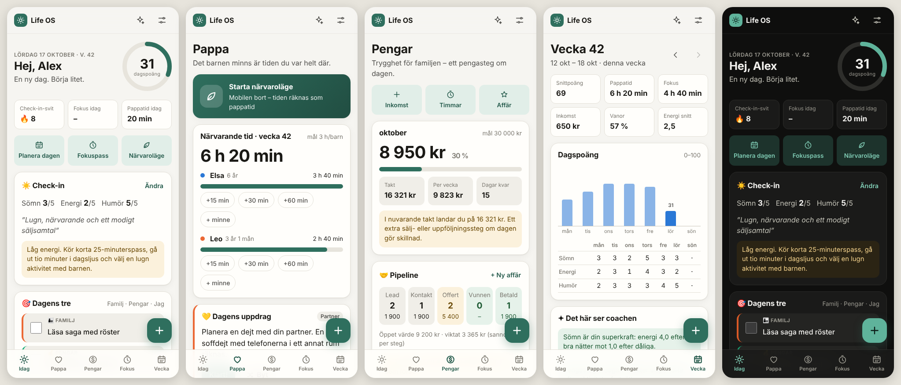

# Life OS – din dag, din familj, din ekonomi

Life OS är en mobil-först app (PWA) som hjälper dig att **vara en närvarande pappa, få
ekonomin att växa och må bra på vägen**, en dag i taget. Appen är byggd för att användas
varje dag på telefonen, fungerar offline och sparar all data lokalt på din enhet.



## Idén: en daglig loop i balans

Appen bygger på en enkel loop där varje dag får **en sak för familjen, en för pengarna och en
för dig själv**:

```
☀️ Morgon-check-in → 🎯 Dagens tre → 💛 Pappa-uppdrag → 💰 Pengasteg → 🌱 Vanor → 🌙 Kvällsreflektion
                                                                         ↓
                                            🗓️ Veckogenomgång varje söndag
```

Allt du gör ger en **dagspoäng (0–100)** som mäter balans, inte prestation.

## Vad appen gör

| Flik | Innehåll |
|---|---|
| **Idag** | Morgon-check-in (sömn, energi, humör + intention) med råd som anpassar sig efter hur du mår · Dagens tre (familj/pengar/jag) · dagens pappa-uppdrag och pengasteg med streaks · vanor · ”för ett år sedan”-minnen · kvällsreflektion där ”viktigast imorgon” automatiskt blir morgondagens prioritet · en dagsplan byggd av dina tider och prioriteringar |
| **Pappa** | **Närvaroläge** (mobilen bort, tiden räknas som pappatid och appen ger en samtalsfråga) · närvarande tid per barn och vecka mot ett mål · 50+ aktiviteter filtrerade efter barnens ålder, årstid, inne/ute, tid och kostnad · middagsfrågor per åldersgrupp · dagliga pappatips · **minnesbank** med citat, stunder och milstolpar (export till Markdown) · födelsedagsnedräkning |
| **Pengar** | Månadsmål med takt, prognos och vad som behövs per vecka · **pipeline** (lead → kontakt → offert → vunnen → betald) med nästa steg, försenade steg och viktat värde · inkomst och timmar per ström → **kronor per timme** · sparmål och buffert i månader · inkomsthistorik |
| **Fokus** | Fokuspass på 25/50/90 min kopplade till dagens prioriteringar, med ljud, vibration och notis när passet är klart · fokus per dag i veckan |
| **Vecka** | Snittpoäng, pappatid, fokus, inkomst, vanor och energi · dagspoäng per dag · sömn/energi/humör-tabell · **insikter från coachen** (t.ex. sömnens effekt på energin, ojämn tid mellan barnen, pengatakt) · vanerutnät · veckans vinster och minnen · veckogenomgång med nästa veckas tre, familjeplan och pengaplan · export till Markdown eller direkt till Agent OS-minnet |
| **Coach** | Inbyggd offline-coach: planera dagen, helgplan med barnen, hjälp att tjäna mer, veckoanalys och stresshjälp – allt baserat på din egen data. Kan kopplas till **Agent OS** för fria frågor till din egen AI-stack. |

Dessutom: **+**-knappen för snabbanteckningar (minne, inkomst, timmar, affär, prioritet,
närvaroläge), kalenderpåminnelser (.ics), ljust/mörkt tema och onboarding i fyra steg.
Innehållet är förifyllt med dina inkomstströmmar (BidSprint 48, ForgeHQ, WordPress-produkter,
lön/jobb) och kan ändras fritt.

## Kom igång

### Alternativ 1 – på telefonen via GitHub Pages (rekommenderas)

1. Slå på Pages: **Settings → Pages → Build and deployment → Source: GitHub Actions**
   (GitHub Pages kräver ett publikt repo eller ett betalt GitHub-konto).
2. Kör workflowen **Actions → Life OS · GitHub Pages → Run workflow** (den körs sedan
   automatiskt när `life-os/public/` ändras på `main`).
3. Öppna `https://<ditt-användarnamn>.github.io/Agent-OS/` på telefonen och installera:
   - **iPhone:** Safari → Dela → *Lägg till på hemskärmen*
   - **Android:** Chrome-menyn ⋮ → *Installera app*

Sidan innehåller bara appens kod. Din data ligger kvar på telefonen.

### Alternativ 2 – lokalt på datorn

Kräver Node.js 20+ och inga beroenden.

```bash
cd life-os
npm start            # → http://127.0.0.1:3020
```

På Windows:

```powershell
cd life-os
.\start.ps1
```

### Alternativ 3 – från telefonen via Tailscale

```powershell
.\start.ps1 -HostAddress 0.0.0.0 -AccessToken "ett-långt-slumpat-lösenord"
```

Öppna sedan datorns Tailscale-adress på port 3020. För att kunna **installera** appen och få
offline-stöd behövs HTTPS, till exempel med `tailscale serve 3020`
([Tailscale Serve](https://tailscale.com/kb/1312/serve)). Exponera aldrig servern direkt mot
internet.

### Utforska först

Tryck **Utforska först med exempeldata** på välkomstskärmen. Exempeldatan raderar du under
Inställningar → Data när du vill börja på riktigt.

## Coachen och Agent OS

Snabbvalen i coachen körs alltid **offline** av en regelmotor som läser din egen data. För fria
frågor kan coachen kopplas till Agent OS, som i sin tur skickar frågan till den modell du kör
via Free Claude Code-proxyn (t.ex. en gratis modell på OpenRouter eller Ollama lokalt):

1. Starta Agent OS (`npm start` i repots rot, port 3001) och FCC-proxyn.
2. Starta Life OS-servern (`npm start` i `life-os/`). Den ansluter till `AGENT_OS_URL`.
3. I appen: **Inställningar → Coach → Läge: Agent OS → Testa anslutning**.

Coachen skickar en kort sammanfattning med frågan: barnens **åldrar** (namn bara om du slår på
det), månadsmål, dagens check-in och prioriteringar samt öppna affärer. Varje svar sparas också
som en konversation i Agent OS.

**Spara veckan i Agent OS-minnet** skriver veckogenomgången som Markdown till din
Obsidian-vault under `Life OS/2026-W42.md`. Då vet alla dina agenter hur veckan gick.

## Data och integritet

- Allt sparas i webbläsarens `localStorage` på enheten. Inga konton, ingen spårning, inga
  externa skript eller typsnitt.
- **Exportera backup (.json)** och **Importera backup** finns under Inställningar → Data.
- Med Life OS-servern igång kan du **spara en kopia på servern** och hämta den på en annan enhet
  (de tio senaste kopiorna sparas i `life-os/data/backups/`).
- Minnesbanken och veckorna kan exporteras som Markdown, till exempel till Obsidian.
- Appen ber webbläsaren om beständig lagring. Exportera ändå en backup då och då.

## Påminnelser

Under **Inställningar → Rytm & påminnelser → Ladda ner påminnelser (.ics)** får du en
kalenderfil med återkommande påminnelser för morgon-check-in, kvällsreflektion och
veckogenomgång (söndag). Öppna filen på telefonen så hamnar påminnelserna i kalendern.

## Miljövariabler (servern)

| Variabel | Standard | Beskrivning |
|---|---:|---|
| `LIFE_OS_HOST` | `127.0.0.1` | Adress att lyssna på |
| `LIFE_OS_PORT` | `3020` | Port |
| `LIFE_OS_TOKEN` | tom | Kräver headern `x-life-os-token` för alla `/api`-anrop utom health |
| `LIFE_OS_DATA_DIR` | `./data` | Var server-backuper sparas |
| `AGENT_OS_URL` | `http://127.0.0.1:3001` | Agent OS för coach och minne |
| `AGENT_OS_TOKEN` | tom | Agent OS-lösenord om det är satt |
| `LIFE_OS_AGENT_ID` | tom | Tvinga en viss Agent OS-agent för coachen |
| `LIFE_OS_COACH` | på | `off` stänger av Agent OS-bryggan |

## Utveckling

```bash
cd life-os
npm test        # 36 deterministiska tester: datum/ISO-veckor/sommartid, poäng, streaks,
                # pengaprognos, pipeline, veckoinsikter, innehåll, coach, server och säkerhet
npm run check   # syntaxkontroll av alla JavaScript-filer
```

Ingen byggprocess och inga beroenden: vanlig HTML, CSS och ES-moduler.

```
life-os/
├── server.mjs               # statiska filer, backup, Agent OS-brygga (inga beroenden)
├── public/
│   ├── index.html, styles.css, manifest.webmanifest, sw.js
│   └── js/
│       ├── core.js          # ren logik: datum, poäng, streaks, pengar, vecka, export
│       ├── content.js       # aktiviteter, uppdrag, samtalsfrågor, tips, pengasteg
│       ├── coach.js         # offline-coach + Agent OS-klient
│       ├── app.js           # router, händelser, timer, service worker
│       ├── store.js, ui.js, sheets.js, timer.js, demo.js
│       └── views/           # idag, pappa, pengar, fokus, vecka, coach, inställningar, onboarding
└── test/                    # node --test
```

Bumpa `CACHE` i `public/sw.js` vid varje release så att installerade appar hämtar den nya
versionen. Appen visar då ”En ny version finns – Uppdatera”.

## Idéer framåt

- Synk mellan enheter med konfliktlösning per post (i dag: manuell backup via servern)
- Push-notiser via servern i stället för kalenderfil
- Bankimport (CSV) för att se utgifter och sparkvot automatiskt
- Hemskärmswidget med dagens tre och dagspoäng
- Delad familjevy med partnern
