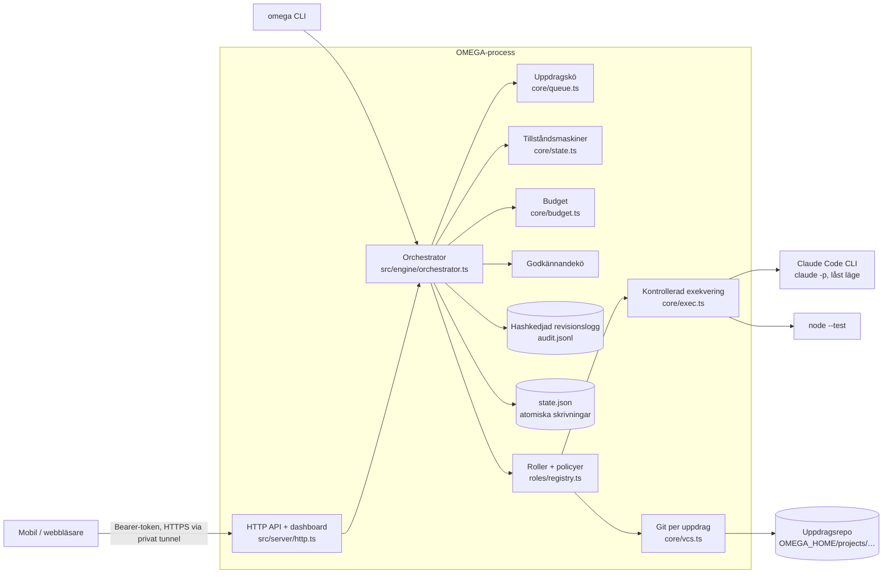
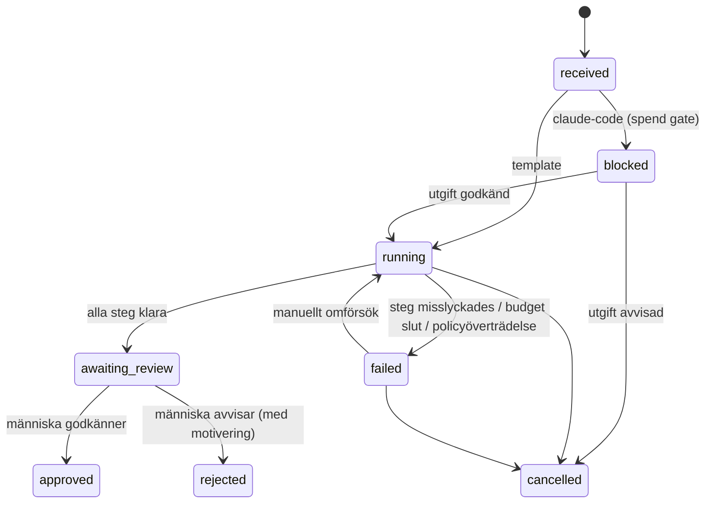

# Fas 2 – Arkitektur

## Designprinciper

1. **Separation of duties.** Den som skriver koden verifierar den inte. Tester skrivs *före* koden av
   en annan roll, körs av OMEGA självt och fingeravtrycks så att kodaren inte kan ändra dem.
2. **Minsta behörighet, upprätthållen av OMEGA.** Varje roll har en policy. OMEGA kontrollerar själv
   (sökvägar, exec-lista, miljö, git-diff efteråt) i stället för att lita på att agenten lyder.
3. **Evidens före påståenden.** Inget visas som "klart" utan en artefakt med SHA-256, en commit eller
   en revisionspost. Allt kan räknas om (`omega verify <id>`).
4. **Människan äger beslut med konsekvenser:** utgifter (spend gate) och slutligt godkännande.
5. **Ärlighet om förmåga.** Mallmotorn är inte AI och säger nej till idéer den inte kan. Planerade
   roller visas som planerade.

## Komponenter



All kod är TypeScript som körs direkt av Node ≥ 22.18 (type stripping). **Inga runtime-beroenden** –
mindre attackyta i leveranskedjan. `typescript`/`@types/node` används bara för `npm run typecheck`.

## Pipeline

```
idé ─▶ product ─▶ architect ─▶ test-author ─▶ coder ─▶ tester ─┬─▶ security ─▶ docs ─▶ slutgranskning (människa)
                                                     ▲          │
                                                     └─ fix ◀───┘  (max OMEGA_MAX_FIX_ITERATIONS, om budget finns)
```

| Roll | Motor | Ansvar | Får skriva | Får köra | Verktyg |
|---|---|---|---|---|---|
| product | Claude / mall | Idé → spec med testbara acceptanskriterier (JSON-schema) | – | – | **inga** |
| architect | deterministisk | Projektskelett, package.json utan beroenden | `package.json`, `.gitignore`, `OMEGA.md`, `src/.gitkeep`, `test/.gitkeep` | – | – |
| test-author | Claude / mall | Acceptanstester *innan* kod finns | `test/**` | – | Read, Glob, Grep, Write, Edit |
| coder | Claude / mall | Implementation | `src/**` | **ingenting** | Read, Glob, Grep, Write, Edit |
| tester | deterministisk | Kör testerna oberoende, integritet + täckning per krav | – | `node --test …` | – |
| security | deterministisk | Statisk granskning: hemligheter, eval, child_process, nätverk, beroenden | – | – | – |
| docs | deterministisk | README från verifierade fakta, försegla evidensmanifest | `README.md`, `docs/**` | – | – |
| research | – | Planerad: webbresearch, endast läsning | – | – | WebSearch, WebFetch |

Kodaren kan inte köra kommandon alls – den får testutdata från testarens körning i nästa varv.

## Tillståndsmaskiner (`src/core/state.ts`)



Uppgifter: `queued → running → succeeded | failed`, `running → queued` vid krasch/återförsök.
Godkännanden: `pending → approved | rejected`. Otillåtna övergångar kastar `TransitionError`.

## Uppdragskö och körning

- Persistenta uppgifter i `state.json`, FIFO, bara för uppdrag i `running`.
- En arbetare (seriellt). Vid omstart återköas uppgifter som stod i `running` (eller markeras misslyckade
  när försöken är slut) – revisionsposter `task.recovered`/`task.abandoned`.
- Processlås (`omega.lock`) hindrar att CLI och server skriver state samtidigt.
- Varje steg: budgetkontroll → kör roll → git-status mot rollens skrivregler (överträdelser återställs,
  LLM-roller misslyckas) → bokför kostnad → commit som `OMEGA <roll>` → nästa steg.

## Versionskontroll

Varje uppdrag är ett eget git-repo. OMEGA committar efter varje steg med rollen som författare, git körs
isolerat från din globala config (inga hooks, signering eller credential helpers), och inga remotes finns.
`git log` blir en läsbar och verifierbar historik över vem som gjorde vad.

## Loggning och evidens

- `audit.jsonl`: append-only, varje post har `prevHash` och `hash = sha256(kanonisk JSON)`. Ändring,
  borttagning eller omkastning upptäcks med exakt postnummer.
- Artefakter per uppdrag (`OMEGA_HOME/missions/<id>/artifacts/`): spec, fullständiga agent-transkript
  (prompt, systemprompt, kostnad, nekade verktygsanrop), rå TAP-logg, testrapport, säkerhetsrapport,
  testfingeravtryck, README och ett **evidensmanifest** som förseglar alla hashar + commits + revisionshuvud.
- `omega verify <id>` / knappen "Verifiera evidens" räknar om allt.

## Budget

Tre tak, kontrolleras före varje betald körning: per körning (`--max-budget-usd`), per uppdrag och per
UTC-dygn. Kostnad bokförs från Claude Codes egen rapport. Minsta tillåtna körning $0,05.

## Behörighet och åtkomst

Se `docs/03-security.md`. Kort: loopback-bindning som standard, token krävs för hela API:t, ingen
terminal/ingen fri kommando-endpoint, strikt CSP, all agent-output renderas som text.

## Väg mot den fullständiga visionen

| Steg | Innehåll | Bygger på |
|---|---|---|
| v0.1 (nu) | En maskin, en arbetare, små Node-appar, Claude Code + mall | – |
| v0.2 | Codex- och Ollama-motorer bakom samma `Engine`-gränssnitt; modellval per roll | `engines.ts` |
| v0.3 | Arbeta mot befintliga repon: egen gren/worktree, PR via `gh` först efter godkännande | `vcs.ts`, policy |
| v0.4 | Starkare sandlåda (Docker/Windows Sandbox) för testkörning; fler projekttyper (webb, Python) | `exec.ts` |
| v0.5 | Research-roll, fler parallella arbetare, SQLite i stället för JSON | `queue.ts`, `store.ts` |
| v0.6 | Mobil åtkomst via Tailscale + Windows-tjänst med verifierad drift, push-notiser vid godkännanden | `server/` |
| senare | Flera användare/roller (RBAC), extern förankring av revisionskedjan, kostnadsprognoser | `audit.ts` |
